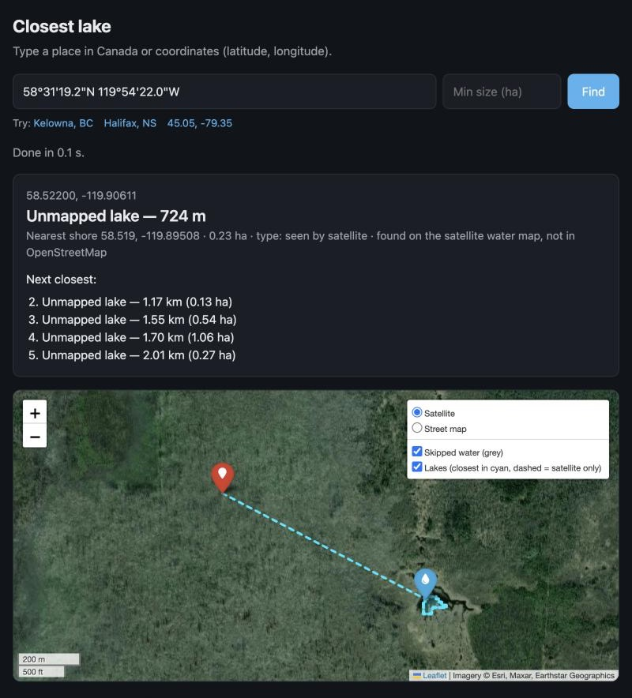

# Nearest Lake

Find the closest lake to any location in Canada. Type a place name or coordinates and get the nearest
lake, the distance to its shore, and a map.



## Setup

Needs Python 3.10 or newer.

```bash
git clone https://github.com/AdrianKarandish/nearest-lake.git && cd nearest-lake
```

```bash
python3 -m venv .venv && .venv/bin/pip install -r requirements.txt
```

On Windows, use `.venv\Scripts\python` wherever this page says `.venv/bin/python`. On macOS, the
built-in Python 3.9 can't connect to the OpenStreetMap servers; install a newer one (for example with
[uv](https://docs.astral.sh/uv/): `uv python install 3.12`) and create the `.venv` with it.

## Use

Web page: start it, open http://localhost:8787 and type a location.

```bash
.venv/bin/python web_app.py
```

Command line:

```bash
.venv/bin/python closest_lake.py "Kelowna, BC"
```

A location can be a place name in Canada or coordinates, either decimal (`45.05 -79.35`) or the way
Google Maps copies them (`43°40'13.9"N 79°22'47.7"W`). Add `--min-size 1` to only count lakes of at
least 1 hectare. Each search saves a map, a CSV of the 20 closest lakes, a GeoJSON and a text summary in
`output/closest/<name>/`.

## How it works

- Lakes, ponds and reservoirs come from OpenStreetMap. Lakes it hasn't mapped (common in the North) are
  added from the ESA WorldCover satellite map and shown as "Unmapped lake" with a dashed outline.
- Rivers, the sea, salt or tidal water, sewage and stormwater ponds and seasonal ponds are skipped.
- It searches 3 km around the location first, then 10, 30 and 80 km if nothing is found.
- Distance is a straight line to the nearest shore.
- The first search in a new area takes from 30 seconds to a few minutes (the free OpenStreetMap server
  is often busy). Repeat searches are instant because map data is cached for 7 days.
- WorldCover is a single snapshot, so lakes that appeared or dried up since aren't reflected, and the
  filters that keep the sea, rivers and city shadows out of the satellite water are rules of thumb.

## Data sources

All free, no accounts or keys needed.

- Lakes, rivers, coastline: © OpenStreetMap contributors (ODbL), via the Overpass API.
- Place names → coordinates: OpenStreetMap Nominatim (fine for occasional lookups; at most 1 request
  per second).
- Unmapped lakes: ESA WorldCover 10 m (CC BY 4.0), © ESA WorldCover project, contains modified
  Copernicus Sentinel data processed by the ESA WorldCover consortium.
- Basemap: Esri World Imagery (display only).

## Tests

```bash
.venv/bin/python -m pytest -q
```

## License

MIT, see `LICENSE`. Downloaded data keeps its own licence (listed above).
